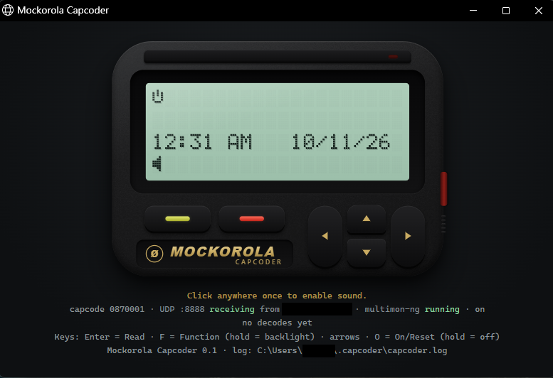

# hme-pager

Python tools for the HME Wireless (JTECH) iStation paging transmitter. One side sends pages through the transmitter; the other receives them off the air with an RTL-SDR and shows them on a virtual pager.

Everything is plain Python 3 with no third-party dependencies, so it runs as-is on Windows, macOS, Linux, or a FreePBX box. The one exception is sending over a serial cable on Windows, which needs `pyserial`.

```
 pager.py / hmew ──HTTP or RS-232──▶ iStation ──RF 457.575 MHz──▶ RTL-SDR ──UDP audio──▶ Mockorola Capcoder
      (send)                         (transmitter)                                         (receive and display)
```

## Hardware tested

Everything here was built and tested against an HME/JTECH **ISTATION-N** transmitter reporting these software versions:

```
PVer: 2.48   RVer: 003
```

Other models or firmware versions may behave differently, particularly in their replies and in how they encode pages on air.

## What's inside

| Path | What it is |
|---|---|
| [`hmew/`](hmew/) | Library that sends pages through the iStation, either over the network (its HTTP interface, `send_page.php`) or over an RS-232 serial cable (the Scope protocol). It checks pager numbers, capcodes and message text before sending, and turns the transmitter's replies into results or clear errors. |
| [`pager.py`](pager.py) | Command line for sending a page, built on `hmew`. |
| [`capcoder/`](capcoder/) | **Mockorola Capcoder**: a virtual Motorola Advisor-style pager that answers to one capcode. See its [README](capcoder/README.md). |
| [`tests/`](tests/) | Unit tests for both sides. |
| [`refdocs/`](refdocs/) | Reference documents: the HMEW Integration Protocol and the Motorola Advisor user manual. |
| [`assets/`](assets/) | Images used in the docs. |
| [`TODO.md`](TODO.md) | Open items for later. |

## Sending pages: `pager.py`

Over the network (HTTP) or a serial cable (RS-232):

```
python pager.py -n -p 3 -h 192.168.1.100 555-1212
python pager.py -a -p 3 -h 192.168.1.100 Barcode error aisle 3
python pager.py -n -p 1 --base 087 -s /dev/ttyS0 5551212
python pager.py -a -c 0870008 -s /dev/ttyS0 Test page
```

```
usage: pager.py (-a | -n) (-p N | -c CAPCODE) (-h HOST[:PORT] | -s DEVICE) [--base NNN] [-v] message ...

Send a numeric or alphanumeric page through the HME/JTECH iStation, over the network (HTTP) or a serial cable (RS-232).

positional arguments:
  message               the message to send

what to send:
  -a, --alpha           send an alphanumeric (text) page
  -n, --numeric         send a numeric page (digits, space, - [ ] U; max 20)

who to page:
  -p, --pager N         pager number, 1-999
  -c, --capcode CAPCODE
                        full 7-digit capcode, e.g. 0870008 (serial only)
  --base NNN            base ID (000-209), needed with -p over serial (default: $HMEWBASE)

how to send:
  -h, --host HOST[:PORT]
                        send over HTTP to this transmitter (default: $HMEWHOST; port 80)
  -s, --serial DEVICE   send over this serial port, e.g. /dev/ttyS0 (default: $HMEWSERIAL)

other:
  -v, --verbose         show what is sent and what the transmitter replies (on stderr)
  --help                show this help and exit

HTTP sends by pager number and the transmitter adds its base ID. Serial sends by full capcode: give -c, or -p with the base ID (--base or
HMEWBASE). Environment defaults: HMEWHOST, HMEWSERIAL, HMEWBASE; if both HMEWHOST and HMEWSERIAL are set, choose with -h or -s. The
message is everything that isn't an option; several words are joined with single spaces (quote it to keep extra spaces). If the message
starts with '-', put '--' before it.
```

The message is checked before anything is sent. A numeric page may contain only digits, space, `-`, `[`, `]` and `U` (up to 20 characters). An alpha page may contain only printable ASCII (up to 128 characters) on either connection. Exit status is 0 on success, 2 for a usage or message error, and 1 if the transmitter rejects the page, gives no reply, answers with an HTTP error, or can't be reached.

### Capcodes, pager numbers and base IDs

Capcode = 3-digit base ID followed by pager × 8 as 4 digits. For example, base 087 and pager 3 give capcode 0870024.

- **HTTP** takes a pager number (1-999), and the transmitter adds its own base ID. HTTP can't address a capcode directly.
- **Serial** takes the full capcode. Give it with `-c`, or give `-p` plus the base ID (`--base` or `HMEWBASE`) and pager.py works out the capcode.

### Serial details

- **Cable:** a straight-through RS-232 cable (not a null-modem cable) with a DB9 male connector at the transmitter end. The transmitter's serial port is a DB9 female.
- **Format:** the Scope format (HMEW doc section 4.A), for example `AF0870008ATest page` followed by a carriage return. The parts are the type (`A` alpha, `N` numeric), `F` for 1200 baud (always sent, as the doc says), the 7-digit capcode, beep `A`, and the message.
- **Port settings:** 9600 baud, 8 data bits, no parity, 1 stop bit, no flow control.
- **Reply:** the unit answers `OK` when it accepts a command, and nothing else, ever. A bad capcode just gets silence. So no `OK` within 3 seconds is reported as an error, with a reminder that a bad capcode looks exactly like that.
- **Group pages:** each capcode gets its own command. If one goes unanswered, the error says how many were already sent, so you don't page those people twice.
- **One sender at a time:** while a page is being sent, the serial port is locked, and a second sender waits up to 10 seconds for its turn.
- **Linux and macOS** need nothing extra; the serial code uses only the standard library. **Windows** needs the `pyserial` package for serial; HTTP needs nothing.
- **Both connections at once:** the unit accepts pages over HTTP and serial at the same time.

### Verbose output

`-v` shows where the transmitter setting came from, exactly what is sent, and the reply with its timing. Over HTTP:

```
pager: HTTP transmitter 192.168.1.100 port 80 (from -h/--host)
hmew: numeric page to pager(s) 3 via 192.168.1.100:80: '555-1212' (beep 1, 1200 baud)
hmew: GET http://192.168.1.100/send_page.php?pager=3&type=1&msg=555-1212&baud=1&beep=1
hmew: reply '!sc1' (HTTP 200) in 42 ms
sent numeric page to pager 3 via HTTP 192.168.1.100: '555-1212' (transmitter replied !sc1)
```

Over serial:

```
pager: serial transmitter /dev/ttyS0 (from -s/--serial), base ID 087
hmew: numeric page to capcode(s) 0870008 via serial /dev/ttyS0: '5551212' (beep 1)
hmew: opened /dev/ttyS0 at 9600 baud, 8N1, no flow control
hmew: write b'NF0870008A5551212\r'
hmew: reply b'OK\r\n' in 12 ms
sent numeric page to pager 1 (capcode 0870008) via serial /dev/ttyS0: '5551212' (transmitter replied OK)
```

### From Python

```python
from hmew import HttpTransmitter, SerialTransmitter, Page, PageType

page = Page(PageType.ALPHA, "Test page", pagers=(1,))

HttpTransmitter("192.168.1.100").send(page)
SerialTransmitter("/dev/ttyS0", base=87).send(page)
SerialTransmitter("/dev/ttyS0").send(Page(PageType.ALPHA, "Test page", capcodes=(870008,)))
```

Both have the same `send(page)` method, so code can take either one. The older `PagerClient("192.168.1.100").send_numeric(pager=3, msg="555-1212")` still works; `PagerClient` is another name for `HttpTransmitter`.

## Receiving pages: Mockorola Capcoder



Capcoder listens for raw demodulated audio over UDP, sent by `rtl_fm` piped into netcat. It decodes the audio with multimon-ng and shows pages for its capcode on a dot-matrix LCD. The buttons, menus and alerts follow the Advisor's user manual. Every decode, for every capcode, goes to a log file.

```
python -m capcoder --base 87 --pager 3
rtl_fm -f 457.575M -s 22050 -g 30 - | nc -u -w1 <capcoder-host> 8888
```

See the [Capcoder README](capcoder/README.md) for setup, options, behavior and testing.

## Tests

```
python -m unittest tests.test_hmew tests.test_hmew_serial tests.test_capcoder
```

The sender's tests never send a real page. HTTP tests use a fake transmitter on 127.0.0.1. Serial tests use a fake port, plus, on Linux and macOS, a pseudo-terminal pair that plays the transmitter (those 4 tests are skipped on Windows).

## Reference

- HMEW Integration Protocol rev 04/13 ([`refdocs/`](refdocs/)). Section 4.D covers the HTTP interface.
- Motorola Advisor user manual ([`refdocs/`](refdocs/)), the model for Capcoder's behavior.

## License

GPL-3.0. See [LICENSE](LICENSE). Capcoder's receiver code is adapted from [mmng-ui](https://github.com/lingfish/mmng-ui), also GPL-3.0.
